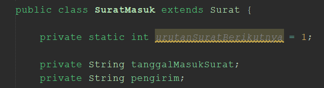
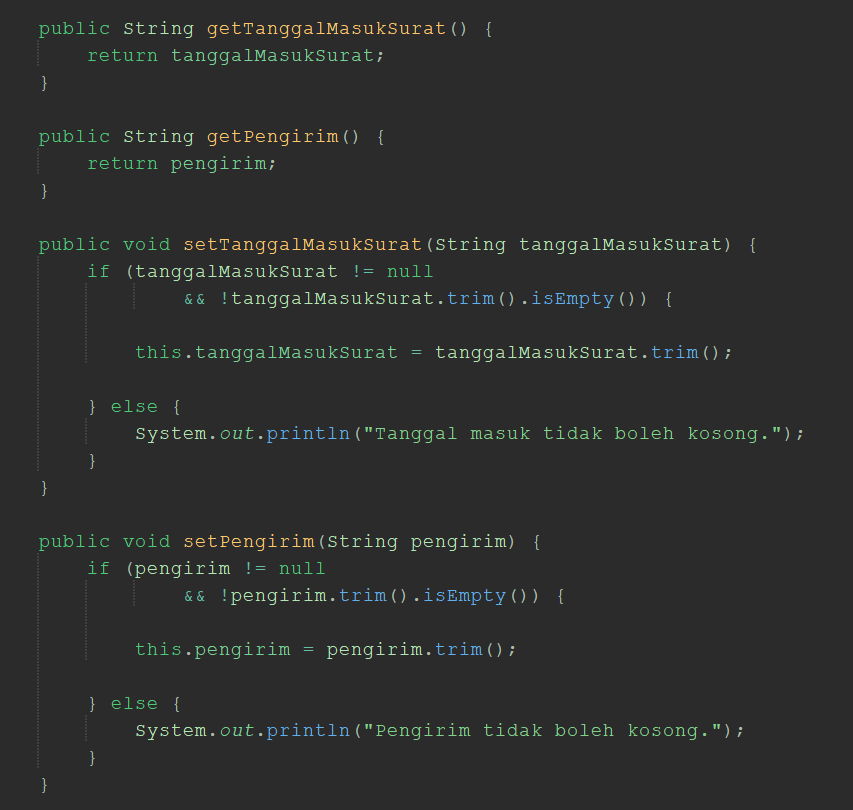
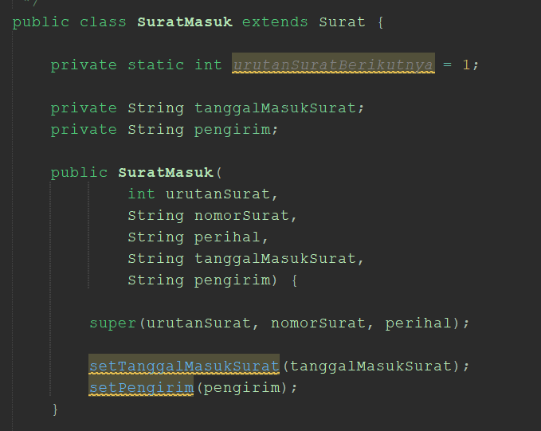
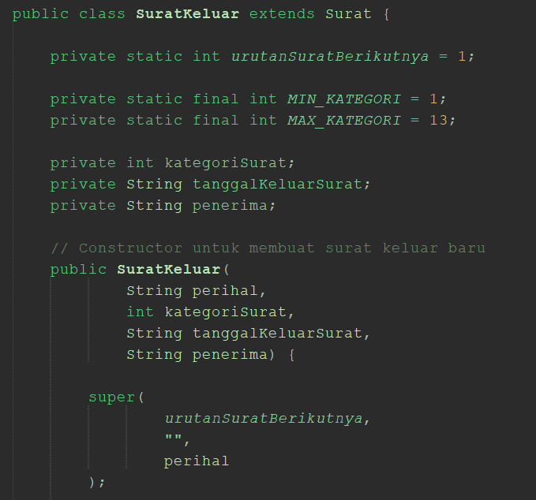
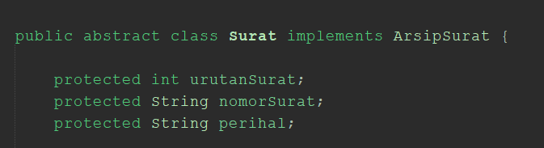
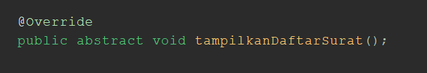
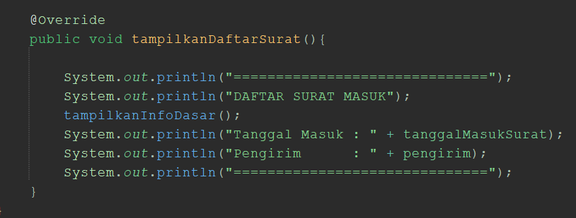
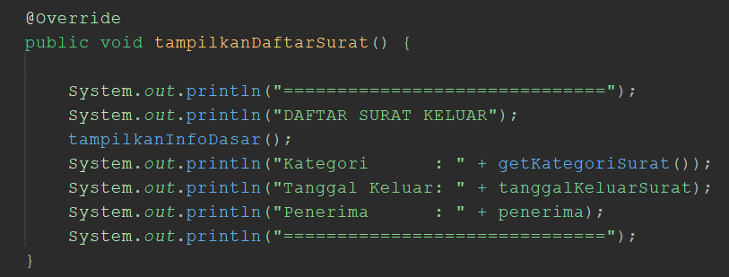
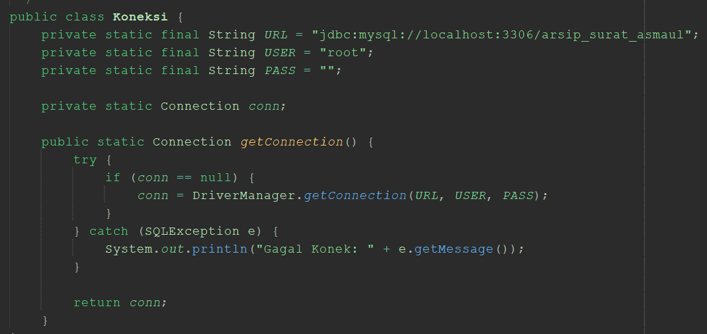
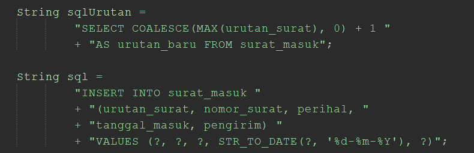

# Sistem Pengarsipan Surat Asrama Putra Universitas Mulawarman

## 1. Deskripsi Program

Sistem Pengarsipan Surat Asrama Putra Universitas Mulawarman adalah program yang dirancang untuk membantu sekretaris asrama dalam mengelola arsip surat masuk dan surat keluar.

Sebelumnya, proses pengarsipan dilakukan menggunakan Excel dan menyimpan file surat ke dalam Google Drive. Kondisi tersebut dapat menyebabkan pekerjaan yang berulang serta menyulitkan ketika sekretaris perlu mencari kembali data surat tertentu.

Sistem ini dibuat sebagai solusi untuk memusatkan pencatatan informasi arsip dalam satu sistem, sekaligus melakukan digitalisasi pada pengarsipan surat Asrama Putra Universitas Mulawarman. Sistem ini berfokus pada pengelolaan informasi arsip yang meliputi pencatatan, pencarian, perubahan, dan penghapusan data surat.

Selain arsip surat, sistem ini juga menyediakan pengelolaan data penghuni asrama. Data tersebut dapat digunakan sebagai referensi ketika sekretaris membutuhkan informasi penghuni dalam proses administrasi surat.

Pada MinPro 4, sistem dikembangkan dengan menghubungkan program Java ke database MySQL menggunakan JDBC, PreparedStatement, dan DAO. Dengan demikian, data surat masuk, surat keluar, dan penghuni dapat disimpan serta dikelola melalui database, sehingga data yang telah tersimpan dapat ditampilkan kembali ketika program dijalankan.

## 2. Kebutuhan Sistem

### Surat Masuk

Sekretaris dapat:

- Melihat arsip surat masuk.
- Menambahkan surat masuk.
- Mengubah data surat masuk.
- Menghapus surat masuk.
- Mencari surat berdasarkan pihak pengirim.

Informasi yang dikelola:

- Nomor surat
- Perihal
- Tanggal surat masuk
- Pengirim

### Surat Keluar

Sekretaris dapat:

- Melihat arsip surat keluar.
- Menambahkan surat keluar.
- Mengubah data surat keluar.
- Menghapus surat keluar.
- Mencari surat berdasarkan pihak penerima.
- Mencari surat berdasarkan kategori.

Informasi yang dikelola:

- Nomor surat
- Perihal
- Kategori
- Tanggal keluar
- Penerima

### Data Penghuni

Sistem menyediakan pengelolaan data penghuni yang meliputi:

- Nama
- NIM
- Asal daerah
- Fakultas
- Jurusan
- Status
- Keterangan

Keterangan bersifat opsional karena tidak semua penghuni membutuhkan informasi tambahan.

## 3. Struktur Package

main:

- Main.java

view:

- View.java

controller:

- ArsipController.java

model:

- ArsipSurat.java
- Surat.java
- SuratMasuk.java
- SuratKeluar.java
- Penghuni.java

dao:

- SuratMasukDAO.java
- SuratKeluarDAO.java
- PenghuniDAO.java

config:

- Koneksi.java
- TestKoneksi.java

Setiap package memiliki fungsi yang berbeda agar program lebih teratur dan mudah dikembangkan. Package main digunakan sebagai tempat _run_ program melalui file Main.java.

Package view digunakan untuk menampilkan menu, menerima input pengguna, dan menampilkan hasil proses program.

Package controller digunakan sebagai penghubung antara View, Model, dan DAO. Di dalamnya ada file ArsipController.java yang menangani pengelolaan data serta meneruskan permintaan dari pengguna ke DAO.

Package model digunakan untuk merepresentasikan objek dan struktur data yang digunakan dalam sistem, yaitu surat masuk, surat keluar, dan penghuni.

Package dao digunakan untuk menangani proses akses database, termasuk CRUD nya menggunakan JDBC.

Package config digunakan untuk mengatur koneksi antara program Java dan database MySQL melalui Koneksi.java. di dalamnya ada TestKoneksi.java yang digunakan untuk mengetes koneksi antara file java ke database untuk memastikan konektivitas database sebelum menyusun program lebih jauh.

## 4. Alur Program

Program dimulai dari Main.java, kemudian sistem menampilkan menu melalui View.java. Pengguna memilih proses yang ingin dilakukan, seperti pengelolaan surat masuk, surat keluar, atau data penghuni.

Setelah pengguna memasukkan pilihan dan data yang diperlukan, View meneruskan permintaan tersebut kepada ArsipController.java. Controller kemudian meneruskan proses pengelolaan data kepada DAO sesuai dengan kebutuhan pengguna.

DAO mengakses database MySQL melalui koneksi yang disediakan oleh Koneksi.java. Proses akses database dilakukan menggunakan JDBC dan PreparedStatement untuk menjalankan perintah SQL dengan parameter.

Data yang berhasil diambil dari database dikirimkan kembali melalui DAO kepada Controller, kemudian ditampilkan melalui View. Sementara itu, proses penambahan, perubahan, dan penghapusan data diteruskan ke database dengan proses dari DAO.

## 5. Penerapan Encapsulation

Encapsulation digunakan untuk menjaga agar data pada objek tidak dapat diakses dan diubah secara bebas dari luar class.

Pada gambar di atas, terdapat dua atribut yang dideklarasikan menggunakan access modifier `private`, yaitu:
- `private String tanggalMasukSurat;`
- `private String pengirim;`
`private` membatasi akses langsung terhadap kedua atribut tersebut dari luar class `SuratMasuk`. Oleh karena itu, akses dan perubahan nilai atribut dilakukan melalui method yang disediakan oleh class.

Data surat dan penghuni dikelola melalui metode getter dan setter yang merupakan metode untuk mengakses data yang di encap. Getter digunakan untuk mengambil, sedangkan setter digunakan untuk mengubah dengan tetap memperhatikan aturan yang telah ditentukan.

Penerapan ini dapat ditemukan pada class Surat, SuratMasuk, SuratKeluar, dan Penghuni.

Pada gambar di atas, terdapat method getter dan setter yang digunakan untuk mengakses atribut:

- `getTanggalMasukSurat()` mengembalikan nilai atribut `tanggalMasukSurat` melalui perintah `return tanggalMasukSurat;`.
- `getPengirim()` mengembalikan nilai atribut `pengirim` melalui perintah `return pengirim;`.
- `setTanggalMasukSurat(String tanggalMasukSurat)` digunakan untuk mengubah nilai tanggal masuk surat.
- `setPengirim(String pengirim)` digunakan untuk mengubah nilai pengirim surat.

Pada kedua setter, kondisi `nilai != null` memeriksa agar nilai tidak `null`, sedangkan `!nilai.trim().isEmpty()` memeriksa agar nilai tidak kosong setelah spasi di awal dan akhir dihilangkan.

Jika nilai memenuhi kondisi, perintah seperti `this.pengirim = pengirim.trim();` menyimpan nilai tersebut ke dalam atribut objek. Jika tidak memenuhi kondisi, program menampilkan pesan bahwa data tidak boleh kosong.

Setter juga dapat digunakan untuk melakukan validasi terhadap data yang diberikan. Sebagai contoh, kategori surat keluar dibatasi pada rentang kategori yang ditentukan, sedangkan tanggal dan informasi pengirim atau penerima diperiksa agar tidak kosong.

Pada data keterangan penghuni, sistem memperbolehkan nilai null karena keterangan merupakan informasi yang bersifat opsional.

Dengan penerapan encapsulation, pengelolaan data objek menjadi lebih terkontrol dan setiap atribut dapat memiliki aturan perubahan sesuai kebutuhan sistem.

## 6. Penerapan Inheritance

Surat masuk dan surat keluar memiliki beberapa karakteristik umum, seperti nomor surat dan perihal, tetapi juga memiliki karakteristik khusus masing-masing. Karena keduanya merupakan jenis surat, digunakan inheritance dengan class Surat yang merupakan informasi umum yang dipakai oleh kedua jenis surat, yaitu:
- Urutan surat
- Nomor surat
- Perihal

Untuk Penerapannya adlaah sebagai berikut:

**SuratMasuk memiliki:**

- Tanggal surat masuk
- Pengirim
  

Pada gambar di atas, deklarasi `public class SuratMasuk extends Surat` menunjukkan bahwa `SuratMasuk` merupakan turunan dari class `Surat`.

Konstruktor `SuratMasuk` menerima parameter `urutanSurat`, `nomorSurat`, `perihal`, `tanggalMasukSurat`, dan `pengirim`. Perintah `super(urutanSurat, nomorSurat, perihal);` memanggil konstruktor class induk untuk menginisialisasi data umum surat, yaitu urutan surat, nomor surat, dan perihal.

Sementara itu, `tanggalMasukSurat` dan `pengirim` merupakan atribut khusus yang dikelola oleh class `SuratMasuk`.

**SuratKeluar memiliki:**

- Kategori surat
- Tanggal keluar surat
- Penerima

Pada gambar di atas, deklarasi `public class SuratKeluar extends Surat` menunjukkan bahwa `SuratKeluar` juga merupakan turunan dari class `Surat`.

Konstruktor `SuratKeluar` menerima parameter `perihal`, `kategoriSurat`, `tanggalKeluarSurat`, dan `penerima`. Perintah `super(urutanSuratBerikutnya, "", perihal);` memanggil konstruktor class induk dengan meneruskan urutan surat, string kosong sebagai nomor surat awal, dan perihal. Nomor surat kemudian dibentuk oleh proses berikutnya dalam konstruktor.

Atribut `kategoriSurat`, `tanggalKeluarSurat`, dan `penerima` digunakan untuk menyimpan informasi khusus surat keluar.

Karena SuratMasuk dan SuratKeluar merupakan turunan dari class Surat, maka saat deklarasinya menggunakan extends.

Penerapan inheritance digunakan agar karakteristik yang sama dapat dikelola pada satu struktur dasar dan tidak perlu dibuat berulang pada setiap jenis surat.

## 7. Penerapan Abstraction

Sistem memiliki konsep umum mengenai sebuah surat, tetapi surat masuk dan surat keluar memiliki informasi serta kebutuhan yang berbeda.

Oleh karena itu, Surat digunakan sebagai abstract class yang menjadi dasar bagi SuratMasuk dan SuratKeluar.

Abstraction digunakan untuk menentukan karakteristik dan perilaku umum yang harus dimiliki oleh setiap jenis surat, sementara detail yang berbeda dapat ditentukan oleh masing-masing jenis surat.

Salah satu perilaku yang harus dimiliki setiap jenis surat adalah kemampuan untuk menampilkan informasi surat melalui method tampilkanDaftarSurat().

Pada gambar di atas, deklarasi `public abstract class Surat implements ArsipSurat` menunjukkan bahwa `Surat` merupakan class abstrak yang mengimplementasikan interface `ArsipSurat`.

`abstract` menandakan bahwa class `Surat` tidak dapat dibuat menjadi objek secara langsung. Class ini digunakan sebagai dasar bagi class turunan seperti `SuratMasuk` dan `SuratKeluar`.

Selain itu, atribut `protected int urutanSurat`, `protected String nomorSurat`, dan `protected String perihal` mendefinisikan data umum yang dimiliki oleh surat dan nantinya akan diikuti oleh surat masuk dan keluar. Lalu digunakan Access modifier `protected` agar atribut tersebut diakses oleh class turunan sesuai aturan akses Java.

Pada gambar di atas, method `public abstract void tampilkanDaftarSurat();` dideklarasikan tanpa isi method.

`abstract` menunjukkan bahwa method tersebut hanya menetapkan perilaku yang harus tersedia pada class turunan, tanpa menentukan detail pelaksanaannya pada class `Surat`.

Class `SuratMasuk` dan `SuratKeluar` kemudian menyediakan implementasi masing-masing untuk menampilkan informasi surat sesuai jenisnya.

Method tersebut diterapkan oleh setiap jenis surat agar informasi yang ditampilkan sesuai dengan karakteristik surat masuk maupun surat keluar.

Dengan abstraction, sistem dapat menentukan struktur umum sebuah surat tanpa harus menyamakan seluruh detail implementasi pada setiap jenis surat.

## 8. Penerapan Polymorphism

Polymorphism digunakan agar suatu konsep atau operasi dapat memiliki perilaku yang berbeda sesuai dengan kebutuhan sistem.

Pada sistem ini, polymorphism diterapkan melalui overriding dan overloading.

### 8.1 Overriding

Surat masuk dan surat keluar memiliki informasi yang berbeda sehingga cara menampilkan informasinya juga berbeda.

Method tampilkanDaftarSurat() diterapkan kembali pada:

- SuratMasuk
- SuratKeluar

Pada gambar di atas, method `tampilkanDaftarSurat()` menggunakan anotasi `@Override` untuk menunjukkan bahwa method tersebut mengimplementasikan kembali method dari class induk.

Implementasi ini menampilkan judul `DAFTAR SURAT MASUK`, memanggil `tampilkanInfoDasar()` untuk menampilkan informasi umum surat, kemudian menampilkan `tanggalMasukSurat` dan `pengirim`.

Pada gambar di atas, method `tampilkanDaftarSurat()` juga menggunakan anotasi `@Override`.

Implementasinya menampilkan judul `DAFTAR SURAT KELUAR`, memanggil `tampilkanInfoDasar()`, kemudian menampilkan kategori surat melalui `getKategoriSurat()`, tanggal keluar, dan penerima.

Kedua class memiliki method dengan nama yang sama, tetapi isi pelaksanaannya berbeda. Perbedaan tersebut memungkinkan setiap jenis surat menampilkan informasi sesuai karakteristiknya.

Overriding digunakan agar setiap jenis surat dapat menampilkan informasi sesuai dengan karakteristiknya masing-masing.

Dengan demikian, satu perilaku umum dapat diimplementasikan secara berbeda berdasarkan jenis surat.

### 8.2 Overloading

Dalam proses pengarsipan, sekretaris memiliki dua kebutuhan pencarian yang berbeda.

Pertama, sekretaris dapat mencari surat berdasarkan pihak yang terlibat, yaitu pengirim pada surat masuk atau penerima pada surat keluar.

Kedua, sekretaris dapat mencari surat keluar berdasarkan kategori.

Kedua kebutuhan tersebut tetap merupakan aktivitas pencarian surat, sehingga digunakan satu nama operasi dengan parameter yang berbeda, yaitu:

- cariSurat(String pihak)
- cariSurat(int kategori)

Kedua method tersebut terdapat pada ArsipController.java.

Dengan demikian, overloading digunakan untuk menangani kebutuhan pencarian yang berbeda dalam satu method cariSurat(), dengan membedakan parameter yang diberikan sesuai dengan jenis pencarian yang dilakukan.

## 9. Penerapan JDBC dan DAO

JDBC (Java Database Connectivity) digunakan untuk menghubungkan program Java dengan database MySQL. Pada MinPro 4, JDBC digunakan agar data surat masuk, surat keluar, dan penghuni dapat disimpan serta dikelola melalui database.

Koneksi database diatur melalui class Koneksi.java yang terdapat pada package config. Class tersebut menyediakan koneksi yang digunakan oleh DAO untuk menjalankan perintah SQL.

Proses akses database dipisahkan ke dalam package dao, yang terdiri dari:

- SuratMasukDAO.java
- SuratKeluarDAO.java
- PenghuniDAO.java

Masing-masing DAO menangani proses pengelolaan data sesuai dengan tabel database yang digunakan.

JDBC diterapkan melalui beberapa komponen, yaitu:

- Connection digunakan untuk mengakses koneksi database.
- PreparedStatement digunakan untuk menjalankan perintah SQL dengan parameter.
- ResultSet digunakan untuk membaca hasil query SELECT.
- executeUpdate() digunakan untuk menjalankan perintah INSERT, UPDATE, dan DELETE.

berikut ini adalah kode koneksinya:

Pada gambar di atas, class `Koneksi` mendefinisikan konfigurasi dan method untuk membuat koneksi database.

- `URL` menyimpan alamat koneksi JDBC, yaitu `jdbc:mysql://localhost:3306/arsip_surat_asmaul`. Alamat ini menunjukkan penggunaan driver MySQL, server lokal, port `3306`, dan database `arsip_surat_asmaul`.
- `USER` menyimpan username database, yaitu `root`, sedangkan `PASS` menyimpan password yang digunakan. Pada konfigurasi ini, password berupa string kosong.
- `private static Connection conn;` mendeklarasikan variabel untuk menyimpan objek koneksi database.
- `getConnection()` merupakan method yang menyediakan koneksi kepada class lain yang membutuhkannya.
- `if (conn == null)` memeriksa apakah objek koneksi belum tersedia. Jika belum, program memanggil `DriverManager.getConnection(URL, USER, PASS)` untuk membuat koneksi.
- `try-catch` menangani kesalahan bertipe `SQLException` yang mungkin terjadi selama proses koneksi. Jika terjadi kesalahan, pesan error ditampilkan melalui `e.getMessage()`.
- `return conn;` mengembalikan objek koneksi agar dapat digunakan oleh class DAO.

PreparedStatement digunakan agar parameter input pengguna dikirim secara terpisah dari struktur perintah SQL. Pendekatan ini membantu mengurangi risiko SQL injection dibandingkan dengan menyusun query melalui penggabungan string input secara langsung.

Pengambilan data dilakukan melalui query SELECT, sedangkan penambahan, perubahan, dan penghapusan data dilakukan melalui perintah SQL yang sesuai.

DAO (Data Access Object) digunakan untuk memisahkan proses akses database dari pengendalian alur program. Dengan pola ini, Controller tidak perlu menuliskan perintah SQL secara langsung untuk setiap proses pengelolaan data.

Berikut ini adalah contoh penerapan sql pada DAO:

Pada gambar di atas, terdapat dua perintah SQL yang digunakan dalam proses penambahan surat masuk.

Pertama, variabel `sqlUrutan` menyimpan query:

`SELECT COALESCE(MAX(urutan_surat), 0) + 1 AS urutan_baru FROM surat_masuk`

Query ini mengambil nilai urutan surat terbesar dari tabel `surat_masuk`, kemudian menambahkan `1` untuk memperoleh urutan berikutnya. Fungsi `COALESCE()` menghasilkan nilai `0` jika nilai maksimum tidak tersedia, sehingga urutan berikutnya dapat dimulai dari `1`.

Kedua, variabel `sql` menyimpan query `INSERT INTO surat_masuk` untuk menambahkan data ke kolom `urutan_surat`, `nomor_surat`, `perihal`, `tanggal_masuk`, dan `pengirim`.

Tanda tanya (`?`) pada bagian `VALUES` merupakan placeholder untuk parameter yang akan diisi menggunakan `PreparedStatement`. Sementara itu, `STR_TO_DATE(?, '%d-%m-%Y')` digunakan untuk mengonversi tanggal berbentuk teks dengan format hari-bulan-tahun menjadi nilai tanggal yang dapat disimpan ke database.

Pada implementasi DAO, query tersebut disiapkan dan dijalankan melalui JDBC. Parameter diisikan menggunakan method seperti `setInt()` dan `setString()`, sedangkan `executeUpdate()` digunakan untuk menjalankan operasi penambahan data.

Database MySQL yang digunakan dalam sistem bernama arsip_surat_asmaul. Struktur tabel dan data awal disediakan melalui file SQL yang disertakan dalam repository.

Data awal dimasukkan melalui file SQL, bukan melalui kode Java, sehingga data dapat langsung ditampilkan ketika fitur pembacaan data dijalankan.

Dengan penerapan JDBC dan DAO, program dapat melakukan pengelolaan data secara langsung terhadap database MySQL dengan struktur program yang lebih terorganisir.

## 10. Kesimpulan

Sistem Pengarsipan Surat Asrama Putra Universitas Mulawarman dikembangkan untuk membantu sekretaris dalam mengelola arsip surat masuk, surat keluar, serta data penghuni secara lebih terstruktur.

Sistem menerapkan konsep MVC untuk memisahkan tampilan, pengendalian proses, dan representasi data. Encapsulation digunakan untuk mengelola serta memvalidasi atribut objek, sedangkan inheritance dan abstraction digunakan untuk mengelola karakteristik umum serta perbedaan antara surat masuk dan surat keluar.

Polymorphism diterapkan melalui overriding untuk menyesuaikan cara menampilkan informasi setiap jenis surat dan overloading untuk menangani kebutuhan pencarian surat yang berbeda.

Pada MinPro 4, sistem menggunakan JDBC dan PreparedStatement untuk menghubungkan program Java dengan database MySQL. DAO digunakan untuk memisahkan proses akses database dari dan alur umum program, sedangkan file SQL digunakan untuk databasenya.

Dengan penerapan konsep tersebut, sistem tidak hanya mendukung kebutuhan pengarsipan surat dan pengelolaan data penghuni, tetapi juga memiliki struktur program yang lebih teratur serta penyimpanan data yang terintegrasi dengan database.
